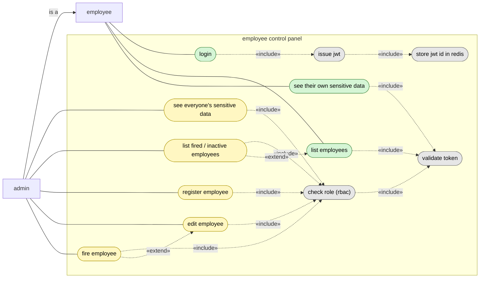

# ARCHITECTURE

## Web App

the web app is an authenticated control panel dashboard

what each role (employee, admin) can do:

| action | employee | admin |
|---|---|---|
| login | yes | yes |
| list employees | yes (only active ones) | yes (active and fired/inactive ones) |
| see name, job title and department | yes | yes |
| see corporate email and phone | yes | yes |
| see wage, cpf, personal phone and address | no (only their own) | yes |
| register / edit employees | no | yes |
| fire employees | no | yes |

Idea (rn):

```
[Angular]                      [NODE API]                  [REDIS]           [POSTGRESQL]
    |                               |                         |                   | 
    |-1. POST /auth/login---------->|                         |                   |
    |                               |-- 2. search user/hash-->|------------------>|
    |                               |<--3. return data--------|-------------------|
    |                               |                         |                   |
    |                               |--4. save jwt id ------->|                   |
    |<--5. return JWT---------------|                         |                   |
    |                               |                         |                   |
    |-- 6. GET /employees---------->|                         |                   |
    |    (auth bearer)              |--7. active token?------>|                   |
    |                               |<-8. ok role VIEWER------|                   |
    |                               |--9. public SELECT------>|------------------>|
    |                               |<-10. filtered data------|<------------------|
    |<-11. JSON (no wage/CPF)-------|                         |                   |

```

use cases:



legend: green = employee, yellow = admin only, grey = internal steps (not triggered by users)
